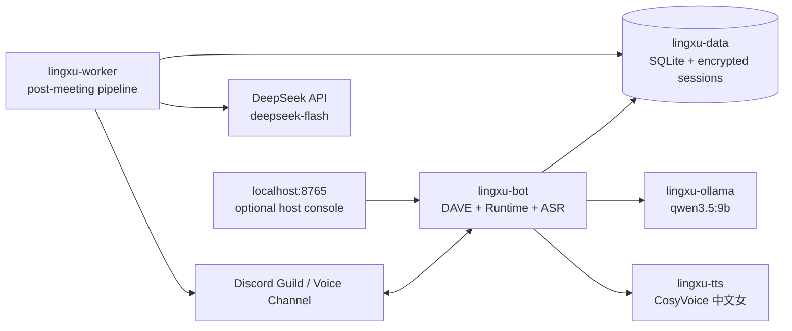

# 聆序 LINGXU


**本地优先的 Discord 语音会议主持、实时语音问答与会后纪要系统。**<br>
**A local-first Discord voice meeting host, real-time voice Q&A assistant, and post-meeting minutes system.**

[中文](#中文简介) · [English](#english-overview) ·
[中文部署](docs/DEPLOYMENT.zh-CN.md) · [English deployment](docs/DEPLOYMENT.en.md) ·
[中文使用](docs/USAGE.zh-CN.md) · [English usage](docs/USAGE.en.md)

[API 与密钥配置](docs/CONFIGURATION.zh-CN.md) · [API and key setup](docs/CONFIGURATION.en.md) ·
[Discord Bot 配置 / Setup](docs/DISCORD_SETUP.md) · [安全 / Security](SECURITY.md)

[CI / 自动验证](https://github.com/Xav13RRR/LINGXU-V2/actions/workflows/ci.yml)

> 本项目采用 [Apache-2.0](LICENSE)。部署时请配置自己的 Discord 和 API 凭据。
>
> Licensed under [Apache-2.0](LICENSE). Configure your own Discord and API credentials before deployment.

> 当前仓库是聆序 LINGXU 的独立部署版本。Discord、语音、ASR、TTS、数据库和 Worker
> 均由本仓库自行部署，不依赖其它项目；议程整理与语音问答使用本地 Qwen，会后最终纪要
> 使用 DeepSeek API。内部包名、容器名和配置前缀使用 `lingxu`，以
> 保持数据库、Docker 卷和升级兼容性。

> This repository contains the independent deployment of 聆序 LINGXU. Discord voice, ASR, TTS,
> persistence, and the post-meeting Worker are deployed from this repository alone. Local Qwen
> handles agenda ingestion and voice Q&A; the DeepSeek API generates final minutes.
> Internal package, container, and configuration identifiers remain `lingxu` for compatibility.

## 中文简介

聆序 LINGXU 是一个面向普通 Discord 语音频道的智能会议主持 Bot。它可以自动组织会议
流程、按用户接收语音、播报议程、管理发言与计时、执行私信投票，并在会议结束后由独立
Worker 生成逐字稿和结构化会议纪要。会议之外，它还可以作为常驻语音指挥中心，仅回答
频道成员问题而不录音、不生成逐字稿或纪要。

### 主要功能

| 板块 | 功能 |
| --- | --- |
| 自动会议主持 | 十秒开场、议程标题与时长播报、定时自动推进、暂停/恢复/前进/返回/跳过/结束 |
| 议程导入 | Slash Command 手工添加，或在会议创建频道中 `@Bot` 上传 `.md`，由本地模型整理后原子写入 |
| Discord 语音 | 普通语音频道双向 DAVE 路径、按 Discord user ID 分离音轨、Bot 同时收听和播报 |
| 多语言 ASR | 本地 SenseVoice 中文、英文及中英混合实时识别；按用户隔离队列和 VAD |
| 本地女声 TTS | 固定 CosyVoice `中文女`，支持议程、计时、投票结果和结束语音播报 |
| 发言与计时 | 发言申请、主持人点名、发言结束、持久化计时器；仅长于 120 秒的流程提示一次剩余 60 秒 |
| 私信投票 | 议程内 Yes/No 投票、参与者快照、私信按钮、服务器命令降级、截止/全员完成自动结算 |
| 实时语音问答 | 默认说“呼叫指挥中心”；管理员可用 `/wakeup` 为每个服务器独立设置，会议与常驻模式共用且活动会话即时生效 |
| 常驻助手 | `/assistant join` 后驻留语音频道，仅进行问答；不创建会议、录音、逐字稿、纪要或 Worker Job |
| 多服务器安装 | 同一个 Bot 可安装到多个 Guild；全局服务器命令安装后可直接使用，本机同一时间只为一个 Guild 执行重型任务 |
| 会后处理 | 独立 Worker 恢复式处理；完整已授权记录紧凑分区发送 DeepSeek，模型返回内容与证据编号，本地排版并插入完整权威表格；模型失败时提供明确标注的基础纪要 |
| 纪要保底 | 模型超时、截断或校验失败时自动输出标注清楚的基础纪要：会议事实、发言摘录和完整已授权记录；未确认结论交由人工核对 |
| 同意与隐私 | 同意按 Guild 隔离并可撤回；录音、实时 ASR、纪要分别执行授权；内容不进入运行日志 |
| 本地主持台 | 可选 localhost 控制台，提供认证、实时状态、议程、发言、计时、投票和手工 TTS |
| 可恢复性 | SQLite/WAL、Alembic、追加式事件、原子文件、加密音频、Worker checkpoint 和重启恢复 |

### 部署架构

Windows GPU 部署使用 Docker Desktop 和 NVIDIA GPU Compose Profile：



- `lingxu-bot`：Discord Gateway、DAVE 语音、会议 Runtime、实时 ASR、语音问答和控制台；
- `lingxu-worker`：独立会后处理、恢复 checkpoint；以完整已授权记录调用
  `deepseek-flash` 获取结构化内容，本地校验、排版并发布最终 `minutes.md`；
- `lingxu-ollama`：私有网络内固定 `qwen3.5:9b`，负责议程导入和两类语音助手问答，宿主机
  不开放 11434；
- `lingxu-tts`：私有网络内 CosyVoice `中文女`，宿主机不开放服务端口；
- `lingxu-data`：SQLite、加密 Session、TTS cache；运行时明文仅位于 tmpfs `/runtime`；
- `lingxu-models`、`lingxu-ollama`、`lingxu-cosyvoice`：独立模型卷。

完整安装、首次模型下载、Discord Application 配置、CPU/GPU 方案和验收命令见
[中文部署指南](docs/DEPLOYMENT.zh-CN.md)。完整会议、投票、语音问答、常驻助手和主持台
流程见[中文使用指南](docs/USAGE.zh-CN.md)。

### 每服务器独立唤醒词

默认唤醒词仍为“呼叫指挥中心”。在任意 Discord 文字频道使用以下服务器命令：

```text
/wakeup show
/wakeup set phrase:<连续 4–16 个汉字>
/wakeup reset
```

`show` 可查看当前服务器的有效值；`set` 和 `reset` 需要“管理服务器”权限。设置仅影响当前
Discord Guild，正式会议与常驻助手共用该值，活动中的语音会话会即时更新，其它服务器不受
影响。设置前会使用固定本地 KWS 模型完成规范化和词表预检；命令响应为私密消息，运行日志
不记录唤醒词值。完整行为与故障排查见
[中文使用指南](docs/USAGE.zh-CN.md#210-会议中的实时语音问答)。

## English overview

聆序 LINGXU is an intelligent meeting host for ordinary Discord voice channels. It can run a
timed agenda, receive per-user voice, announce each stage, manage a speaking queue, conduct private
Yes/No votes, and hand the completed session to an independent Worker for transcript and minutes
generation. Outside meetings, it can stay in a channel as a voice command centre that answers
questions without recording or producing transcripts or minutes.

### Core capabilities

| Area | Capability |
| --- | --- |
| Automated facilitation | Ten-second opening, agenda and duration announcements, timed progression, pause/resume/next/back/skip/stop |
| Agenda ingestion | Add items with slash commands or mention the Bot with one `.md` file for local-LLM extraction and atomic import |
| Discord voice | Bidirectional DAVE path in ordinary voice channels, tracks separated by Discord user ID, simultaneous receive and playback |
| Multilingual ASR | Local SenseVoice recognition for Chinese, English, and mixed speech with per-user queues and VAD |
| Local female TTS | Pinned CosyVoice `中文女` for agenda, timer, vote-result, and closing announcements |
| Speaking and timers | Request/advance/finish speaking turns and persistent timers with one 60-second reminder only for stages longer than 120 seconds |
| Private voting | Agenda-linked Yes/No ballots, participant snapshot, DM buttons, guild-command fallback, deadline and early completion |
| Real-time voice Q&A | Default “呼叫指挥中心”; `/wakeup` gives each Guild its own live Meeting/resident phrase, with in-sentence confirmation and no playback interruption |
| Resident assistant | `/assistant join` keeps Q&A in a channel without meetings, recording, transcripts, minutes, or Worker jobs |
| Multi-Guild installation | Install one Bot in multiple Guilds; global Guild-only commands work without per-Guild configuration, while one local deployment serves one active Guild at a time |
| Post-meeting pipeline | Independent restart-safe Worker; compact complete consented records go to DeepSeek for structured claims/evidence, with local layout and authoritative tables; model failures produce labelled basic minutes |
| Basic minutes on model failure | Timeouts, truncation or rejected output produce labelled meeting facts, attributed excerpts and the full consented record; unverified conclusions require human review |
| Consent and privacy | Guild-scoped, revocable consent; separate recording/ASR/minutes enforcement; no meeting content in operational logs |
| Local host console | Optional authenticated localhost UI for status, agenda, consent, speakers, timers, votes, scenarios, and manual TTS |
| Recovery | SQLite/WAL, Alembic, append-only events, atomic files, encrypted audio, Worker checkpoints, and restart recovery |

### Deployment architecture

The Windows GPU deployment uses Docker Desktop and the NVIDIA GPU Compose
override. It runs four production services: `lingxu-bot`, `lingxu-worker`, `lingxu-ollama`, and
`lingxu-tts`. Ollama provides local agenda and voice-assistant inference; the Worker sends the
privacy-filtered complete transcript as compact input to `deepseek-flash`, then validates its
structured response and composes final minutes locally. Ollama and TTS have no published host ports;
persisted meeting data stays in the independent
`lingxu-data` volume, while plaintext runtime audio is restricted to tmpfs.

See the [English deployment guide](docs/DEPLOYMENT.en.md) for Discord setup, model downloads,
CPU/GPU profiles, validation, backup, and upgrade steps. See the
[English usage guide](docs/USAGE.en.md) for meetings, Markdown agenda import, consent, speaking,
voting, live Q&A, resident mode, artifacts, and the host console.

### Per-Guild wake phrases

The immutable fallback remains “呼叫指挥中心”. Run these Guild commands from any Discord text
channel:

```text
/wakeup show
/wakeup set phrase:<4–16 consecutive Han characters>
/wakeup reset
```

`show` displays the effective phrase for that Guild. `set` and `reset` require Manage Guild. A
change affects only the current Guild, is shared by formal Meetings and resident-assistant mode,
and updates an active voice runtime immediately. Persistence occurs only after normalisation and a
pinned local KWS vocabulary preflight. Responses are ephemeral and operational logs never contain
the phrase value. See the
[English usage guide](docs/USAGE.en.md#210-real-time-voice-qa-during-a-meeting) for the full contract
and troubleshooting steps.

## Model stack / 模型栈

| Role / 用途 | Selected model / 选定模型 | Source / 链接 |
| --- | --- | --- |
| Agenda import and meeting/resident voice Q&A / 议程导入、会议及常驻语音问答 | `qwen3.5:9b` Q4_K_M via local Ollama | [Ollama](https://ollama.com/library/qwen3.5:9b) · [Hugging Face](https://huggingface.co/Qwen/Qwen3.5-9B) |
| Final full-transcript minutes / 完整逐字稿最终纪要 | `deepseek-flash` via the official API; complete transcript plus authoritative agenda/aggregate-vote facts, thinking-high, explicit 131,072-token output bound, no automatic retry | [DeepSeek API](https://api-docs.deepseek.com/) |
| Realtime and offline ASR / 实时与离线语音识别 | `iic/SenseVoiceSmall` | [ModelScope](https://modelscope.cn/models/iic/SenseVoiceSmall) |
| VAD / 语音活动检测 | `iic/speech_fsmn_vad_zh-cn-16k-common-pytorch` `v2.0.4` | [ModelScope](https://modelscope.cn/models/iic/speech_fsmn_vad_zh-cn-16k-common-pytorch) |
| Wake word / 唤醒词 | `sherpa-onnx-kws-zipformer-zh-en-3M-2025-12-20` | [sherpa-onnx model index](https://k2-fsa.github.io/sherpa/onnx/kws/pretrained_models/index.html) |
| Mandarin female TTS / 中文女声 | `FunAudioLLM/CosyVoice-300M-SFT` | [Hugging Face](https://huggingface.co/FunAudioLLM/CosyVoice-300M-SFT) · [CosyVoice](https://github.com/FunAudioLLM/CosyVoice) |
| Offline text normalisation / 离线文本规范化 | `pengzhendong/wetext` | [ModelScope](https://modelscope.cn/models/pengzhendong/wetext) |

Runtime uses pinned revisions and SHA-256 manifests recorded in [docs/MODELS.md](docs/MODELS.md).
Model replacement is fail-closed and requires an explicit review; floating `latest` assets are not
accepted as production identity.

## Quick start / 快速开始

First installation requires Discord credentials, an encryption key, the approved local model
downloads, and a DeepSeek API key stored with Windows current-user encryption. Do not run the
launcher before completing the first-install guide.

首次安装必须先配置 Discord 凭据、独立加密密钥、下载固定本地模型，并以 Windows 当前用户
加密方式保存 DeepSeek API 密钥。不要在这些步骤完成前直接运行一键启动器。

```powershell
git clone https://github.com/Xav13RRR/LINGXU-V2.git LINGXU
Set-Location LINGXU
if (-not (Test-Path .env)) { Copy-Item .env.example .env }

# Follow docs/DEPLOYMENT.zh-CN.md or docs/DEPLOYMENT.en.md to fill .env and download models.
# The prompt is masked; the key is stored outside the repository as a DPAPI-encrypted blob.
powershell -ExecutionPolicy Bypass -File scripts/set_deepseek_api_key.ps1

# 按部署指南填写 .env、下载模型并保存加密 API 密钥后：
.\启动聆序.cmd
```

For production multi-Guild use, leave `DISCORD_TEST_GUILD_ID` blank so the Bot synchronises global
Guild-only commands. Use the Developer Portal installation link to add the same Application to each
server. Meetings, resident mode, and agenda-model processing share one durable local slot;
another Guild receives `服务容量已满` without learning which Guild is active. Formal Meetings keep
the slot through Worker publication. If the localhost host console is enabled, set its single
`HOST_CONSOLE_GUILD_ID` explicitly.

生产多服务器使用时应将 `DISCORD_TEST_GUILD_ID` 留空，使 Bot 同步仅限服务器的全局命令。
通过开发者门户安装链接把同一个 Application 添加到多个服务器即可。正式会议、常驻模式和
议程模型处理共享一个持久化本机槽位；其它服务器只会看到“服务容量已满”，不会获知
正在使用的服务器。正式会议会占用到 Worker 发布纪要结束。若启用本地主持台，必须显式填写
其唯一的 `HOST_CONSOLE_GUILD_ID`。

CPU compatibility mode / CPU 兼容模式：

```powershell
powershell -ExecutionPolicy Bypass -File scripts/start_lingxu.ps1 -Cpu
```

The launcher builds the shared application image once and reuses an unchanged TTS image. Use
`-RebuildAll` only for an explicit full TTS rebuild; use `-DryRun` for validation without builds or
Lingxu service changes (Docker Desktop may be started if needed).

下载后先阅读 [API 与密钥配置](docs/CONFIGURATION.zh-CN.md) 和
[Discord Bot 配置](docs/DISCORD_SETUP.md)：使用自己的 Discord Token、Application ID、
独立文件加密密钥和 DeepSeek API Key。本地 Ollama 的 API Key 默认留空。
Windows 推荐掩码输入脚本配合启动器；直接运行 Compose 不会读取 DPAPI 密文。
已有部署不要覆盖 `.env` 或重新生成数据加密密钥。

After downloading, follow [API and key setup](docs/CONFIGURATION.en.md) and
[Discord Bot setup](docs/DISCORD_SETUP.md). Supply your own Discord token, Application ID,
file-encryption key and DeepSeek key; local Ollama keys stay blank. The Windows masked prompt works
with the launcher, not bare Compose. Do not overwrite an existing `.env` or regenerate its data key.

Bot 的发布频道必须允许 **Attach Files**；否则会议处理完成后也可能无法发送纪要附件。
The publication channel must allow **Attach Files**, or completed minutes may fail to upload.

## Security and project status / 安全与项目状态

- 密钥只保存在受限的本地 `.env` 或仓库外加密凭据存储；Git 忽略不等于文件访问保护。
- 真实会议音频、逐字稿、纪要、运行记录、身份标识和私有测试结果不得进入 GitHub。
- 已授权会议文字和允许的身份标签会由 Worker 发往 DeepSeek；并非完全离线处理。
- DPAPI 只保护宿主机上的密文，Docker 管理员仍可查看注入容器的环境变量。
- 测试使用合成数据；真实会议内容、运行记录和私有样本统计不得提交。
- 详细提交检查、私密报告方式和数据边界见 [SECURITY.md](SECURITY.md)。

- Real credentials belong only in ignored `.env` or repository-external encrypted credential
  storage; never commit Bot tokens, API keys, or encryption keys.
- Audio, transcripts, minutes, model traffic, DAVE/MLS material, and anonymous-vote mappings are
  excluded from operational logs.
- The one-click launcher decrypts the DeepSeek credential from Windows current-user DPAPI storage
  into its process environment and passes it to Worker; it clears its injected host variable at
  exit. Docker administrators can still inspect the container environment.
- Real Meeting execution/generation records and private test evidence must not enter GitHub.
  Ignoring a file is not access control, and current-tree cleanup does not erase Git history.
- Consented meeting text and permitted speaker labels leave the host for DeepSeek processing.
- Persistent user audio is encrypted with AES-256-GCM and controlled by Guild-scoped consent.
- LLMs are schema-bounded proposal/summary components and cannot mutate meeting state.
- Test coverage and outstanding manual acceptance checks are documented in
  [docs/TEST_REPORT.md](docs/TEST_REPORT.md).

## Documentation / 文档

- [中文部署指南](docs/DEPLOYMENT.zh-CN.md) / [English deployment](docs/DEPLOYMENT.en.md)
- [中文使用指南](docs/USAGE.zh-CN.md) / [English usage](docs/USAGE.en.md)
- [API 与密钥配置](docs/CONFIGURATION.zh-CN.md) / [API and key setup](docs/CONFIGURATION.en.md)
- [Discord Bot 配置 / Setup](docs/DISCORD_SETUP.md)
- [Security / 安全](SECURITY.md)
- [Licence scope / 许可范围](docs/RIGHTS_CLEARANCE.md)
- [Source release checks / 源码发布检查](docs/PUBLICATION_REVIEW.md)
- [Architecture](docs/ARCHITECTURE.md)
- [Operations](docs/OPERATIONS.md)
- [Models and immutable identities](docs/MODELS.md)
- [Privacy boundary](docs/PRIVACY.md)
- [Failure recovery](docs/FAILURE_RECOVERY.md)
- [Rollback](docs/ROLLBACK.md)
- [Test evidence](docs/TEST_REPORT.md)

## Licence / 许可证

Copyright © 2026 Xav13RRR. 代码、相关测试及所附 Banner 采用 Apache License 2.0，完整条文见
[LICENSE](LICENSE)，归属说明见 [NOTICE](NOTICE)。第三方依赖和模型保留各自许可证。
详见[许可范围](docs/RIGHTS_CLEARANCE.md)及[代码来源](docs/CODE_PROVENANCE.md)。

Project code, related tests and the included banner use Apache License 2.0; see [LICENSE](LICENSE)
and [NOTICE](NOTICE). Third-party dependencies and models retain their own licences. See
[licence scope](docs/RIGHTS_CLEARANCE.md), [code provenance](docs/CODE_PROVENANCE.md)
and [dependencies](docs/DEPENDENCIES.md).
